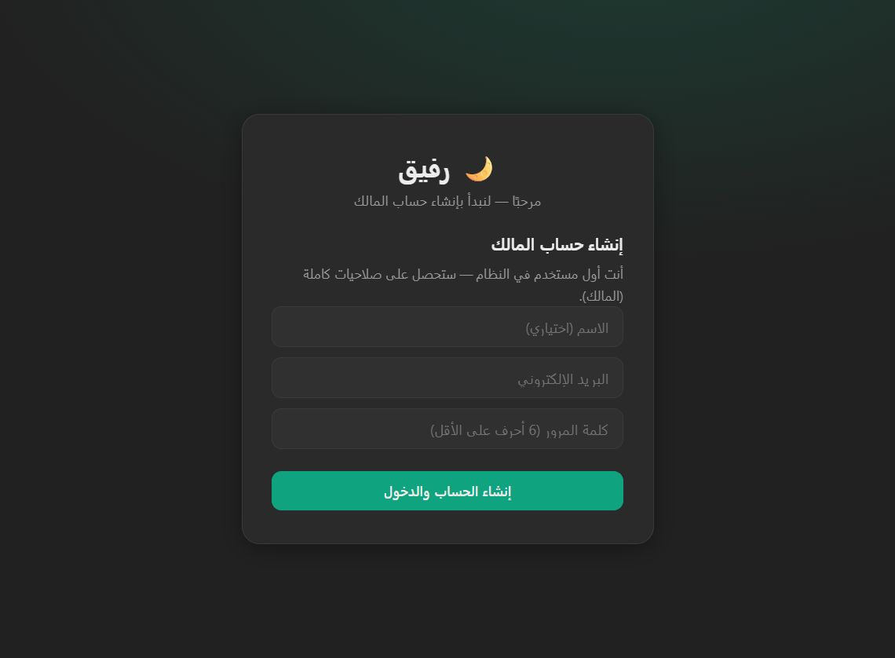

# 🌙 رفيق — Rafeeq

<p align="center">
  
</p>

مساعد صوتي عربي كامل (شبيه ChatGPT) يعمل **محليًا بالكامل** من نماذجك الأصلية الثلاثة:

| المرحلة | النموذج | الملف |
|---|---|---|
| 🎧 الاستماع | **Jais-ASR** (تفريغ عربي/لهجات + كشف اللهجة) | `الاستماع Jais-ASR/` |
| 🧠 التفكير | **Jais-3-7B** (ردود عربية + تفكير داخلي) | `التفكير Jais 3 7B/` |
| 🔊 الكلام | **SILMA TTS** (نطق عربي مشكّل طبيعي) | `التحدث SILMA TTS/` |

> ⚠️ ضع مجلدات النماذج الثلاثة أعلاه في جذر المشروع (مثل هذا الجهاز) — لا تُرفع على GitHub لأن حجمها أكبر من 25 جيجابايت.

## المزايا
- 🎤 **صوت لحظي**: اضغط الميكروفون وتحدث → يستمع، يفكر، ويرد بصوت عربي — مع **مقاطعة طبيعية** (barge-in) مثله مثل إنسان.
- 💳 **فوترة بالدقيقة (لا بالتوكن)**: باقات شهرية + رصيد شحن + حد أدنى 30 ثانية/دقيقة.
- 🔑 **مفاتيح API متوافقة مع OpenAI**: `POST /v1/chat/completions` + `/v1/audio/speech` + `/v1/audio/transcriptions`.
- 👑 **حساب مالك وصلاحيات**: owner / admin / user — لوحة إحصائيات، إدارة مستخدمين، باقات، إعدادات، سجل تدقيق.
- 🌐 واجهة عربية RTL كاملة، جلسات محادثة محفوظة، وSSE للبث.

## التشغيل
```powershell
py -3.11 -m venv .venv
.venv\Scripts\pip install -r requirements.txt
.venv\Scripts\python -m app.main
```
ثم افتح: **http://127.0.0.1:8000** — أول تشغيل يطلب إنشاء حساب المالك.

## البنية
```
app/
  main.py          # خادم FastAPI + تحميل النماذج مسبقًا
  config.py        # إعدادات
  db.py            # SQLite: مستخدمون/باقات/فوترة/محادثات/إعدادات
  security.py      # pbkdf2 + JWT + أدوار وصلاحيات
  billing.py       # الفوترة بالدقيقة
  pipeline/        # asr.py (Jais-ASR) · llm.py (Jais-3-7B) · tts.py (SILMA)
                   # audio.py · sentence.py · state.py · stream_util.py
  routes/          # auth · chat · voice(WebSocket) · keys · billing · admin · openai_api
static/            # الواجهة: index.html + app.js + style.css
vendor/            # بديل nemo_text_processing على ويندوز
```

## بروتوكول الصوت (WebSocket `/ws/voice`)
- اتجاه المايك: إطارات `PCM16 @ 16kHz` ثنائية.
- كشف نهاية كلام بالمُحلّل الطاقي VAD (قابل للضبط من الإعدادات).
- الرد: نص متدفق + جُمل صوتية `WAV @ 24kHz` (base64) — يبدأ النطق قبل اكتمال رد النموذج.

---
صُنع بـ 🔥 لجيس (Jais) من G42/معهد النماذج التأسيسية و SILMA AI.
